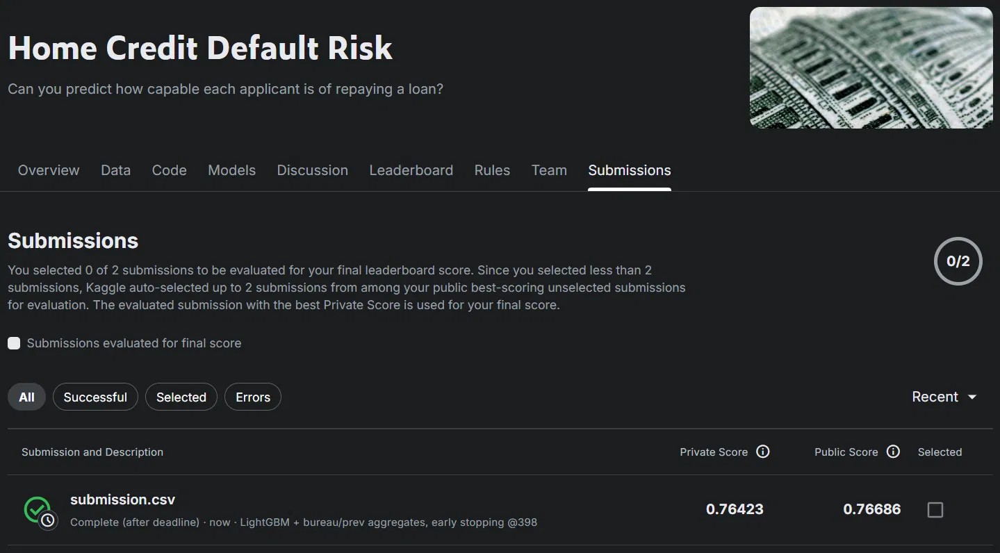
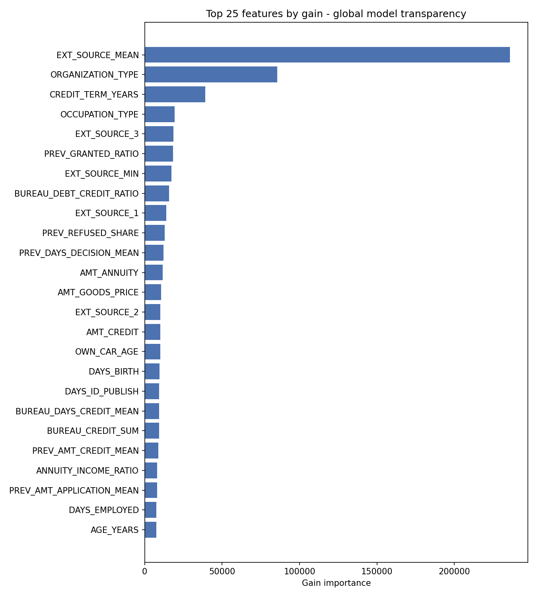
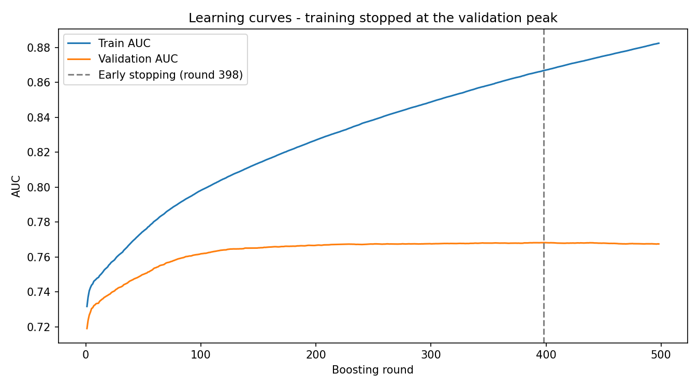
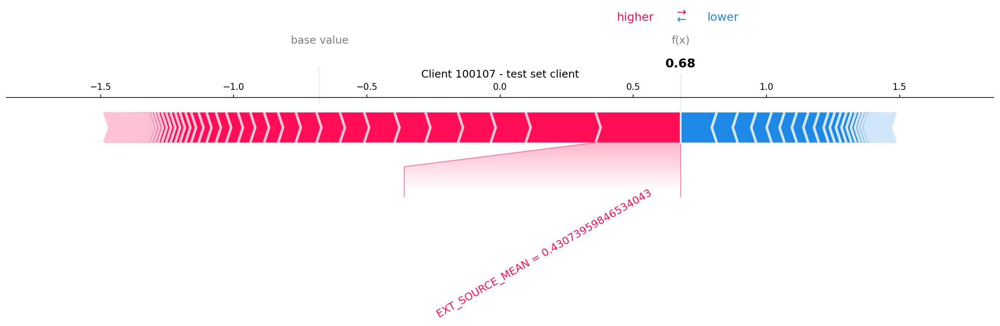
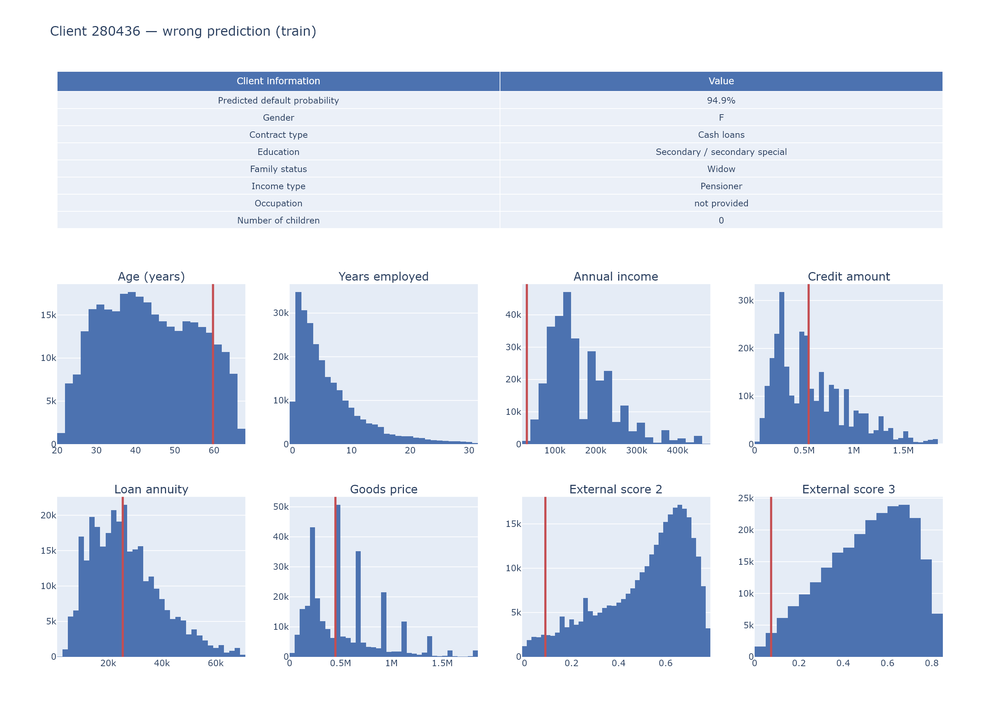

# Credit Scorer

Created by `vishu2726`


An end-to-end credit scoring and explainable ML project for the Home Credit Default Risk dataset. It predicts each client's probability of default and explains the decision behind the score so the outcome is not just accurate, but understandable.

## Overview

This project tackles a real-world credit risk challenge using 307k loan applications across 7 relational tables. The goal is simple but important: score applicants accurately while providing transparent explanations for model decisions.

The pipeline includes:

- feature engineering across multiple relational tables
- leakage-safe dataset creation
- gradient boosting with early stopping
- probability calibration and validation metrics
- SHAP-based explainability for individual predictions

## Results

| Evaluation | AUC |
|---|---|
| Validation (early stopping, round 398) | 0.768 |
| Held-out test set, unseen during training | **0.77** |
| Kaggle public leaderboard | 0.767 |
| Kaggle private leaderboard | **0.764** |

This exceeds the project threshold and demonstrates the model remains strong under real unseen data.



## Highlights

- Feature engineering across relational tables: per-client aggregation for bureau and previous application data, plus domain-driven ratios such as credit-to-income and annuity-to-income.
- Leakage-safe pipeline: a single source of truth for training, prediction, and explanation ensures consistent data handling.
- Controlled model complexity: LightGBM with early stopping, row and feature subsampling, and minimum leaf restrictions reduce overfitting risk.
- Explainable scoring: SHAP force plots and client-level dashboards show how features drive final decisions.

## What the model learned



The most important predictors are external credit scores, followed by employer-related variables and engineered credit-history ratios. These patterns align with the underlying credit risk logic and make the model easier to trust.



The validation AUC rises and then plateaus, which is exactly where the training process stops to avoid unnecessary overfitting.

## Explaining individual decisions

Every scored client gets a SHAP force plot, which highlights the features pushing the prediction toward default (red) or repayment (blue).



Three representative clients are included in the results folder with detailed dashboards and raw-value comparisons against the wider client population.

| File | Client | Story |
|---|---|---|
| `client1_correct_train.pdf` | 156227 | Correctly identified as a true defaulter with strong confidence |
| `client2_wrong_train.pdf` | 280436 | Model predicted default but the client repaid; this highlights irreducible uncertainty in the data |
| `client_test.pdf` | 100107 | Unlabelled test client scored at 66.3% default risk |



## Repository structure

```text
├── data/                          # Home Credit CSVs (git-ignored, ~2.5 GB)
├── results/
│   ├── model/                    # model artifacts, learning curves, reports
│   ├── feature_engineering/      # EDA notebook
│   └── clients_outputs/          # explained clients and dashboards
├── scripts/
│   ├── preprocess.py             # data cleaning and feature engineering
│   ├── train.py                  # model training and early stopping
│   ├── predict.py                # validation and submission logic
│   └── explain.py                # feature importance and SHAP outputs
├── requirements.txt
├── username.txt
├── README.md
└── .gitignore
```

## Getting started

Requirements:

- Python 3.11
- Home Credit dataset downloaded and extracted so CSV files live directly inside `data/`
- [Home Credit Default Risk dataset](https://assets.01-edu.org/ai-branch/project5/home-credit-default-risk.zip)

```bash
git clone https://github.com/vishu2726/credit-scorer.git
cd credit-scorer

python -m venv venv
source venv/Scripts/activate      # Linux/macOS: source venv/bin/activate
pip install -r requirements.txt
```

## Run the pipeline

```bash
python scripts/train.py
python scripts/predict.py
python scripts/explain.py
```

- `train.py` trains the LightGBM model and saves learning curves and model artifacts.
- `predict.py` evaluates the held-out set and generates the Kaggle-style submission file.
- `explain.py` produces SHAP summaries, feature importance, and per-client explanations.

Exploratory analysis can also be opened with:

```bash
jupyter notebook results/feature_engineering/EDA.ipynb
```

## Methodology notes

The detailed report lives in [results/model/model_report.txt](results/model/model_report.txt). It covers:

- why accuracy is not the right metric in this imbalanced setting
- overfitting controls and stopping decisions
- model design and feature strategy
- limitations and future improvements

Created by `vishu2726`.
